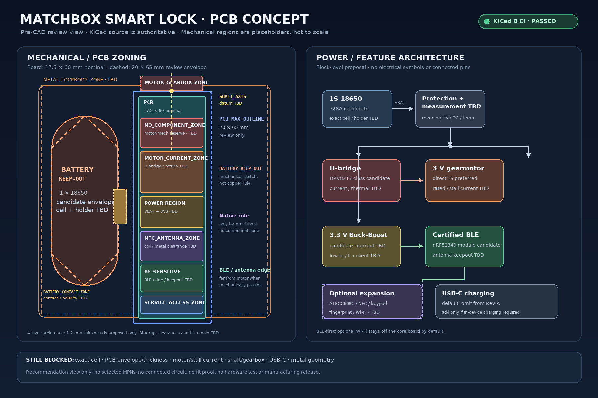

# LockPCB — 火柴盒门锁 PCB 工程

这是室内改装式、免打孔/免布线门锁的 PCB 设计起点。KiCad 工程包含机械占位 PCB 和文字式电源/信号架构草案；尚无已选电气器件、真实原理图连接、PCB 布线、制造输出或硬件验证。

## 开始

- 在 KiCad 中打开 `pcb/LockPCB.kicad_pro`；同目录含 `.kicad_sch` 与 `.kicad_pcb`。
- 需求、机械输入、功耗预算、功能分区及候选决策见 `docs/` 与 `decisions/`。
- CI workflow：`.github/workflows/kicad-ci.yml`；CI 明确固定并校验 KiCad 8 主版本。
- `pcb/LockPCB.kicad_pcb` 是 PCB 与机械层表达的唯一 source of truth。Gerber 尚未导出，也不作为设计源文件。

## Visual overview

[Open the full-size preview directly on GitHub](https://github.com/lin2mm/LockPCB/blob/arena/3b84c22f-lockpcb/docs/previews/engineering-overview.png) · [Open the raw PNG](https://raw.githubusercontent.com/lin2mm/LockPCB/arena/3b84c22f-lockpcb/docs/previews/engineering-overview.png)

> Derived discussion graphic only; not to scale and not a substitute for KiCad source or mechanical validation. The direct GitHub link may require repository access. See [`docs/previews/README.md`](docs/previews/README.md).

## 当前状态

**PRE-CAD placeholder 阶段，不可投板。** `Edge.Cuts` 17.5 × 60 mm 是首轮 nominal 起点，`PCB_MAX_OUTLINE` 20 × 65 mm 是临时 review envelope；两者都不是最终外形。推荐 1.2 mm 板厚仍待确认。电池、电机、轴线、金属壳体及各 keepout 边界未完成 fit 验证。原理图仅表达架构/信号意图，无 pin-level connectivity。查看 GitHub Actions 获取最新 KiCad ERC/DRC 报告。
